

<picture>
  <source media="(max-width: 600px)" srcset="assets/hero-mobile.svg" />
  
</picture>

 

<a href="https://dribbble.com/">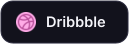</a>
<a href="https://linkedin.com/in/andresblz">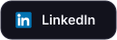</a>
<a href="https://twitter.com/andr3kt">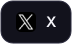</a>
<a href="https://wuolah.com">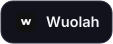</a>

 

<picture>
  <source media="(prefers-color-scheme: dark)" srcset="assets/sec-work-dark.svg" />
  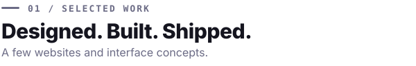
</picture>

<a href="https://jornadas.secusal.net">
  <picture>
    <source media="(max-width: 600px)" srcset="assets/work-secusal-mobile.svg" />
    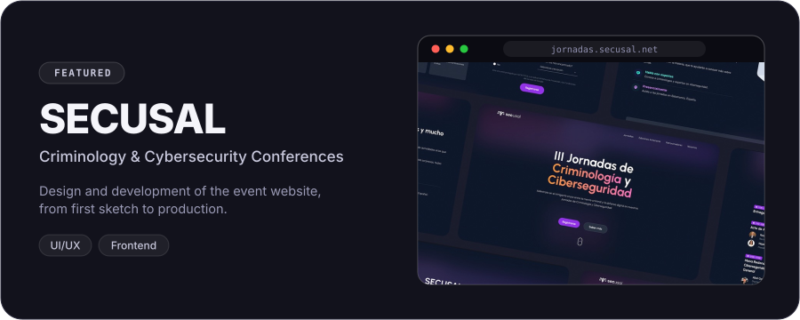
  </picture>
</a>

<a href="https://dribbble.com/">
  <picture>
    <source media="(max-width: 600px)" srcset="assets/diaweb-stack.svg" />
    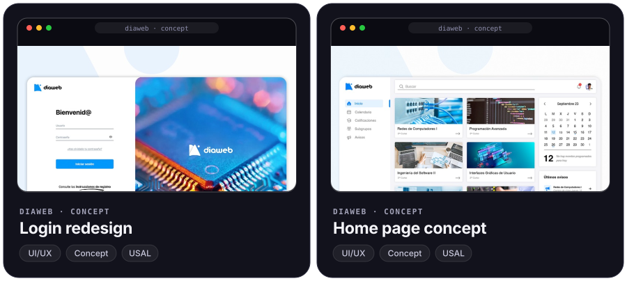
  </picture>
</a>

 

<picture>
  <source media="(prefers-color-scheme: dark)" srcset="assets/sec-how-dark.svg" />
  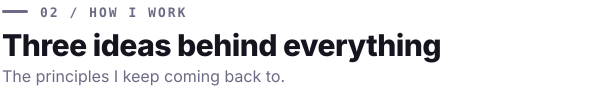
</picture>

<picture>
  <source media="(max-width: 600px)" srcset="assets/how-stack.svg" />
  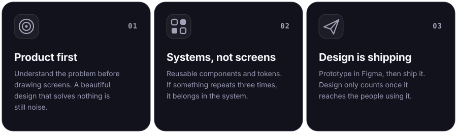
</picture>

 

<picture>
  <source media="(prefers-color-scheme: dark)" srcset="assets/sec-tools-dark.svg" />
  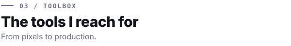
</picture>

<picture>
  <source media="(max-width: 600px)" srcset="assets/toolbox-mobile.svg" />
  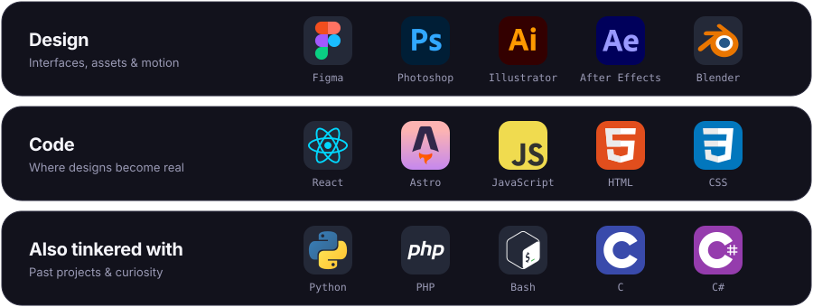
</picture>

 

<picture>
  <source media="(prefers-color-scheme: dark)" srcset="assets/sec-now-dark.svg" />
  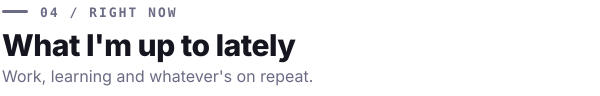
</picture>

<picture>
  <source media="(max-width: 600px)" srcset="assets/now-stack.svg" />
  
</picture>

 

 

<picture>
  <source media="(prefers-color-scheme: dark)" srcset="assets/footer-dark.svg" />
  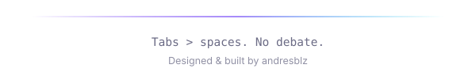 spaces. No debate." width="600" />
</picture>

